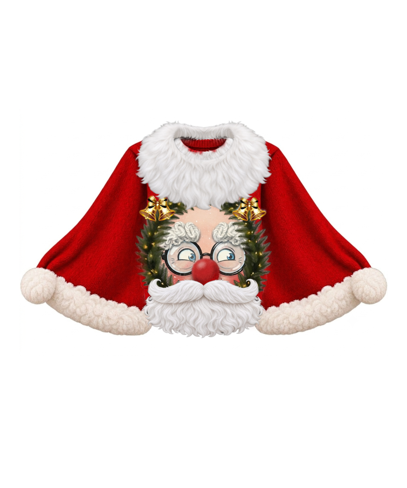

\# Santa's Festive Creations

\### A Christmas Graphic Design Collection

\## 1. Project Overview

Santa's Festive Creations is a Christmas-themed graphic design project consisting of two creative designs: a unique Christmas sweater and a matching holiday greeting card.

The project explores how familiar Christmas elements can be combined creatively to produce attractive festive designs.

\## 2. Inspiration

Christmas sweaters are popular during the holiday season. I wanted to create something different from ordinary Christmas sweater designs.

My idea was to recreate Santa Claus's distinctive appearance using the sweater itself. I used Santa's cap, moustache and beard as the main design elements.

I also wanted the holiday card to follow the same Santa-inspired theme so that both designs would feel connected.

\## 3. Design Concepts

\### A. Christmas Sweater

The sweater is the main design of this project.

\- Santa's cap, moustache and beard are the primary elements.

\- The sleeves are designed to resemble Santa's cap, widening towards the wrist.

\- The moustache and beard are arranged towards the lower part of the sweater.

\- The beard is also incorporated into the neck design.

\- A red ball represents Santa's nose.

\- Garlands and bells are added as festive decorations.

\### B. Holiday Greeting Card

The holiday card follows the same visual theme as the sweater.

\- Uses Santa's cap, moustache and beard.

\- Includes Merry Christmas text.

\- Maintains a simple festive appearance while complementing the sweater design.

\## 4. Tools and Technologies Used

| Tool | Purpose |

|---|---|

| Google Gemini | Generating individual visual elements for the sweater |

| Photopea | Cropping, rotating, removing backgrounds and arranging sweater elements |

| Adobe Photoshop | Generating the holiday card artwork and adding text |

| ChatGPT | Learning editing techniques and understanding tool features |

| Online Tutorials | Learning Photopea operations |

\## 5. Creative Process

\### Sweater Design

1\. Planned the concept based on Santa Claus's appearance.

2\. Generated individual design elements using Google Gemini.

3\. Imported the elements into Photopea.

4\. Cropped, selected, rotated and removed backgrounds where required.

5\. Arranged and combined the elements to create the sweater design.

6\. Added decorative details such as garlands and bells.

7\. Finalised the composition and saved the design.

\### Holiday Card Design

1\. Planned a holiday card inspired by the sweater.

2\. Used Adobe Photoshop's Generate Image feature to create the card artwork.

3\. Added the Merry Christmas text.

4\. Finalised the greeting card design.

\## 6. Challenges Faced and Solutions

Initially, I found it difficult to identify and use some of Photopea's editing tools.

\- \*\*Cropping and rotating:\*\* I struggled to identify the correct options during the initial stage. I explored the available tools and learned how to use them.

\- \*\*Background removal:\*\* I initially found it difficult to remove unwanted backgrounds. Later, I discovered the Magic Cut feature as an alternative method.

\- \*\*Element arrangement:\*\* Combining different elements into one sweater design required time and experimentation.

\- \*\*Learning new tools:\*\* I referred to ChatGPT and online tutorial videos to understand the editing process.

\## 7. Skills and Knowledge Gained

Through this project, I gained practical experience in:

\- Digital image editing.

\- Layering and image composition.

\- Cropping, rotating and background removal.

\- Combining separate visual elements.

\- Creative problem-solving.

\- Exploring and learning new design tools.

\## 8. Final Outcome

The project resulted in two complementary Christmas designs:

1\. A unique Santa-inspired Christmas sweater.

2\. A matching holiday greeting card.

The sweater was the most time-consuming part of the project because it involved combining multiple individual elements into one complete design.

Completing this project helped me understand the importance of photo editing, layering and experimentation in digital graphic design.

\## 9. Conclusion

Santa's Festive Creations was a valuable creative learning experience. It allowed me to transform a simple Christmas-inspired idea into two visual designs while exploring different editing tools and techniques.

The project improved my understanding of digital design and encouraged me to experiment with new creative ideas.

\---

\*\*Project Category:\*\* Graphic Design / Digital Creativity  

\*\*Project Name:\*\* Santa's Festive Creations

## 10. Project Gallery

### Christmas Sweater

### Holiday Greeting Card

## 11. Original Design Assets

The Elements folder contains the original images generated using Google Gemini before editing.

These images were imported into Photopea, where I experimented with background removal, cropping, rotation and layering to create the final sweater composition.
